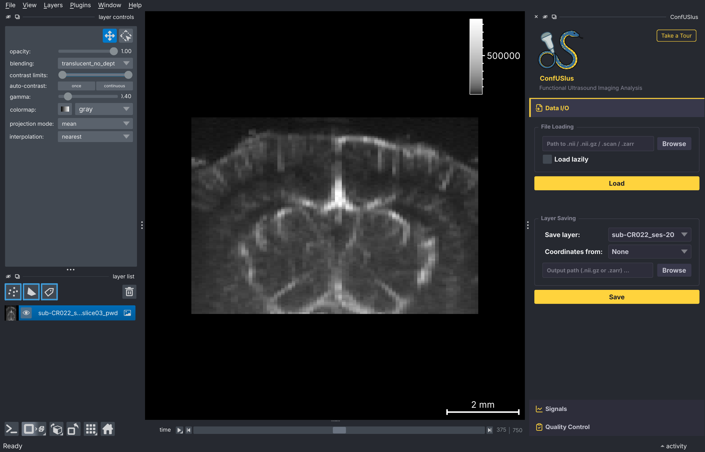
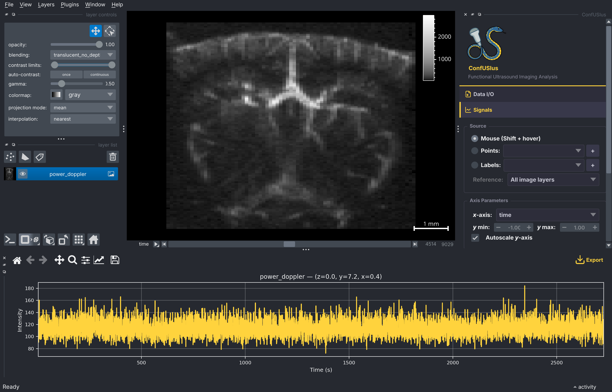
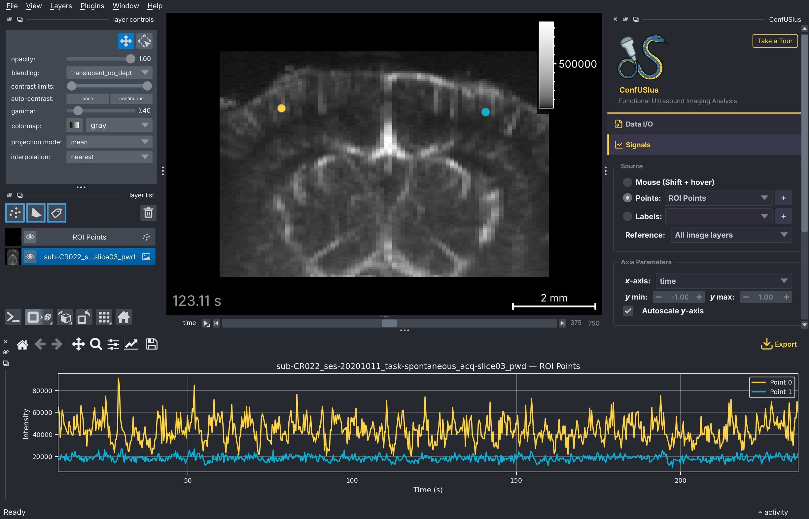
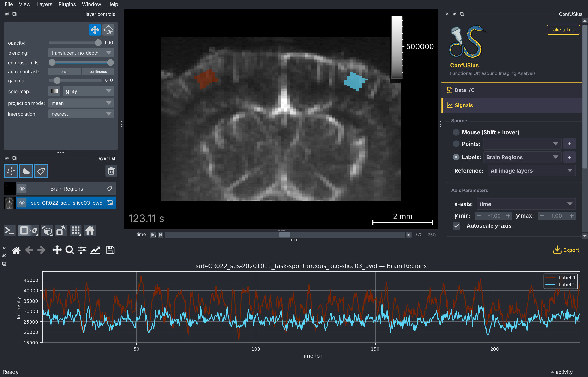
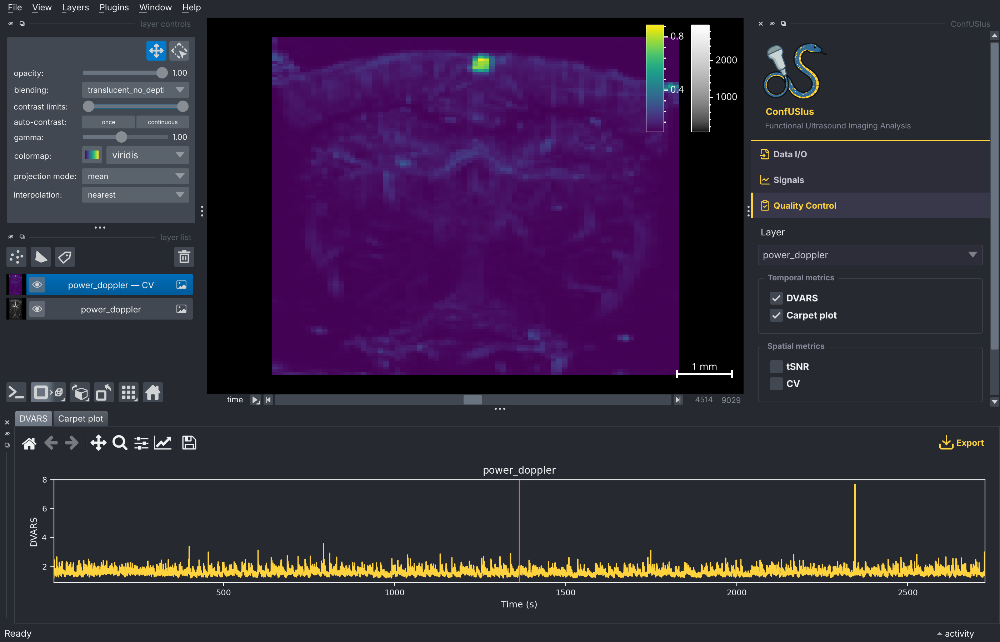

# Using the Plugin

The ConfUSIus sidebar contains five collapsible panels. Each panel operates
independently and can be expanded or collapsed by clicking its header. For an in-app
introduction, click **Take a Tour** in the sidebar header.

- [**Data I/O**](#data-io-panel) — load and save fUSI files (NIfTI, Zarr, SCAN) and
  load behavioral videos.
- [**Signals**](#signals-panel) — plot voxel, point, or label-region signals in a bottom dock.
- [**Events**](#events-panel) — annotate periods of time (BIDS events) and shade them on
  the signal plot.
- [**QC**](#qc-panel) — compute DVARS, carpet, CV, tSNR for a selected layer.
- [**Registration**](#registration-panel) — run between-scan or within-scan
  registration, inspect progress, and save/apply transforms.

## Data I/O Panel

The Data I/O Panel handles loading and saving fUSI files and loading behavioral videos
without leaving the viewer.



### Loading data

Use **Load Data** for both fUSI files and behavioral videos. Click **Browse** to pick
a file—it loads immediately on selection. Or paste a path and click **Load** (or press
++enter++). Video extensions are sent to the video viewer; other paths use the fUSI
loader. **Load** stays disabled until a path is entered.

Enable **Load lazily** beforehand to keep large fUSI arrays Dask-backed. This option is
disabled for video paths, since videos already decode frames on demand. A progress bar
animates while fUSI data loads, and errors are reported in napari notifications.

!!! info "Time overlay"
    When a loaded scan contains a time dimension, the current time coordinate is
    displayed as a text overlay in the bottom-left corner of the canvas. The value and
    units are read from the scan's coordinate metadata and update automatically as you
    scrub the time slider.

    When multiple scans are open, the overlay reflects the currently selected layer.
    If zero or more than one layer is selected, it keeps following the previously
    selected one.

### Loading a video

The same panel opens behavioral videos (`.mp4`, `.mov`, `.avi`) in a second napari
viewer, the video viewer, docked between the main canvas and the ConfUSIus sidebar.
The video viewer has its own layers, axes and camera, so a video never changes how
your fUSI layers are displayed. The two viewers share only time: moving the time
slider of one moves the other to the same time, converting the recording's time units
to or from seconds for the video viewer.

1. Type a video path in **Load Data** and click **Load** (or press ++enter++), or click
   **Browse** to pick a file and add it right away.
2. The video viewer opens with the video as a new layer.

Closing the video viewer or its layer list only hides it. Use **Show video viewer** or
**Show video list** in the Data I/O panel to bring it back. Each button is enabled only
while its dock is hidden and videos are loaded.

Repeat to add more videos: the video viewer shows them side by side in its grid. Frame
`n` of a video is shown at `n / fps` seconds, so a video lines up with a recording whose
time coordinate starts at the first video frame.

!!! tip "Launch with a video from the CLI"
    Pass `--video` to open a video at launch, with or without data files:
    ```bash
    confusius path/to/scan.nii.gz --video path/to/camera.mp4
    confusius --video path/to/camera.mp4
    ```


The video layers are listed in a **video layer list** dock under napari's own layer list,
so they behave like any other napari layers: select, rename, reorder or hide them as
you would in the main viewer. Right-click a layer for a short advanced menu. The delete
button sits above the list; transpose, grid, and frame step sit below it:

| Control | Description |
|---------|-------------|
| **Frame step** | Show every *N*-th frame of the videos. Higher values skip frames for lighter playback of long or high-frame-rate recordings. The effective frame rate becomes `fps / N`, and the time slider still reports time in seconds. |
| **Transpose** | Swap the two displayed axes of the video viewer. |
| **Grid** | Toggle the grid of the video viewer. Without it, the videos are drawn on top of each other. Right-click the button to set the grid stride, width, height and spacing. |
| **Delete** | Remove the selected videos. |

napari's **Home** button and ++ctrl+r++ reset the view of both viewers. Removing the
last video hides the video viewer.

!!! tip "Napari playback performance"
    Napari handles animations quite smoothly up to around 30 to 50 FPS (even higher
    depending on user hardware and operating system). Use **Frame step** to reduce the
    effective frame rate if playback is choppy or buffering.

### Saving data

1. Select the layer to save from the **Save layer** dropdown.
2. Optionally select a layer in the **Coordinates from** dropdown to borrow its physical
   coordinates and attributes. This is useful when saving a labels layer drawn on top of
   a fUSI image: selecting the image layer as the template preserves the full physical
   coordinate system. If the labels layer has fewer dimensions than the template (e.g. a
   3D labels layer against a 4D image), the trailing spatial dimensions are used
   automatically.
3. Type an output path or click **Browse**. The format is inferred from the extension:
   `.nii` / `.nii.gz` for NIfTI and `.zarr` for Zarr.
4. Click **Save**. A notification confirms success.

!!! warning "Multi-pose data"
    Saving multi-pose data from the plugin is not yet supported. Use the Python API to
    consolidate poses first or select a single pose before saving.

Three save modes are applied automatically depending on what is available:

| Mode | When applied |
|------|-------------|
| **Direct** | The layer was loaded via ConfUSIus (DataArray in metadata). Saved verbatim, all coordinates and attributes preserved. |
| **Template** | A template layer is selected. Coordinates are borrowed from the template DataArray. |
| **Reconstruct** | No template and no DataArray in metadata (e.g. a freshly drawn labels layer). Coordinates are reconstructed from the napari layer state (`scale`, `translate`, `axis_labels`). |

## Signals Panel

The Signals Panel plots signals extracted from image layers along any non-spatial
dimension (time, lag, feature, etc.). The plot appears in a bottom dock that is created
the first time you click **Show Signal Plot**.

### Choosing a data source

Pick one of three source modes in the **Source** group:

**Mouse**
: Hold ++shift++ and move the mouse over the canvas. The plot updates live with the
  single-voxel signal at the cursor position.



**Points**
: Select a Points layer from the dropdown (or click **+** to create one). Each point
  is plotted as a separate line colored by its face color. Add or remove points in
  napari and the plot updates automatically.



**Labels**
: Select a Labels layer from the dropdown (or click **+** to create one). The mean
  signal is extracted for each distinct non-zero label and plotted as a separate line,
  colored by the label's color in the napari colormap. This is useful for quickly
  comparing region-averaged signals after painting ROIs with napari's brush tool.



In Points and Labels modes, the **Reference** dropdown selects which image layer to
extract signals from. It defaults to **All image layers**, which plots each layer as a
separate line (distinguished by line style).

### Axis parameters

| Option | Description |
|--------|-------------|
| ***x*-axis** | Choose which non-spatial dimension to plot on the horizontal axis. Defaults to `time` when available, otherwise the first non-spatial dimension. |
| ***y* min / *y* max** | Manual limits for the vertical axis (disabled while autoscale is on). |
| **Autoscale *y*-axis** | When enabled, the vertical axis rescales to fit the data automatically. Disabling it captures the current limits so you can fine-tune them. |

### Display options

| Option | Description |
|--------|-------------|
| **Show grid** | Show or hide the background grid. |
| **Show x-axis cursor** | Draw a vertical line on the plot that follows the napari dimension slider for the selected *x*-axis dimension. |
| **Z-score signal** | Normalize each signal to zero mean and unit variance before plotting. The *y*-axis label changes from "Intensity" to "Z-score". |

!!! tip "Click to navigate"
    Left-click anywhere on the signal plot to jump the napari viewer to the
    corresponding time slice. Clicks are ignored while a zoom or pan tool is active
    in the plot toolbar.

### Managing signals

Click **Manage Signals** to open a floating dialog where you can customize both live
signals (from the current source mode) and imported signals:

- **Rename**: Double-click a signal's name to edit it.
- **Recolor**: Click the color swatch to pick a new color. Changes are synced back to
  the napari layer (point face color or label colormap).
- **Show / Hide**: Toggle individual signal visibility with the checkbox.

### Importing and exporting signals

**Import**
: In the Manage Signals dialog, click **Import** to load one or more signal files at
  once. Standard CSV / TSV files must contain a column whose header matches the
  current *x*-axis dimension name (e.g. `time`) plus one or more numeric value
  columns. BIDS physio files ending in `_physio.tsv.gz` are also supported: ConfUSIus
  reads their JSON sidecar, uses the declared column names, and synthesizes `time`
  from `SamplingFrequency` and `StartTime` when needed. Each value column becomes a
  separate signal overlaid on the plot.

**Export**
: Click the **Export** button in the plot toolbar to export all currently plotted
  signals—both live and imported—to a CSV or TSV file.

## Events Panel

The Events Panel allows annotating *periods of time*—not individual frames—following the
[BIDS
events](https://bids-specification.readthedocs.io/en/stable/modality-agnostic-files/events.html)
convention (`onset`, `duration`, and an optional `trial_type`). Annotated events shade
the [signal plot](#signals-panel) and are named in the time overlay while they are
active.


### Annotating events

1. Type a name for the event in the **Event** field (defaults to `event`).
2. Press **Start (S)** to mark the onset at the current time step, scrub the time
   slider forward, then press **End (E)** to mark the offset. **Cancel (Esc)** discards
   an in-progress annotation. The shortcuts are active whenever the panel is open.
3. The event appears in the table with its trial type, onset, end, and duration.

The End time must not be before the Start time. Ending at the Start time creates an
instantaneous (zero-duration) event, as allowed by BIDS; it is drawn as a vertical line
instead of a shaded band.

### Loading and saving

Use **Load** to import a BIDS events `.tsv` file (`onset` and `duration` are required; a
missing `trial_type` defaults to `event`) and **Save** to write the current events back
out as a BIDS events `.tsv`.

!!! tip "Straight into analysis"
    An events `.tsv` saved here is a standard BIDS events table, so it can be read back
    with [load_events][confusius.bids.load_events] and fed directly to either
    [make_first_level_design_matrix][confusius.glm.make_first_level_design_matrix] or
    the `fit` method of a [FirstLevelModel][confusius.glm.first_level.FirstLevelModel]:

    ```python
    from confusius.bids import load_events
    from confusius.glm import FirstLevelModel

    events = load_events("sub-01_task-rest_events.tsv")
    model = FirstLevelModel(hrf_model="glover").fit(fusi_scan, events=events)
    ```

### Display options

| Option | Description |
|--------|-------------|
| **Shade events on signal plot** | Draw each event as a colored band spanning its interval on the bottom-dock signal plot, colored by trial type. |
| **Show active events in time overlay** | Append each active event to the time overlay as `name [onset, end)`. An event is active while the current frame's acquisition window overlaps it. The window comes from the layer's `volume_acquisition_reference`/`volume_acquisition_duration` metadata, using the frame spacing as the duration when only the reference is present, and the frame's timestamp alone when neither is; an event too short to be sampled by any frame is shown on the next frame instead. |

## QC Panel

The QC Panel computes quality control metrics for a selected image layer.



Select a layer from the **Layer** dropdown, check the metrics you want, and click
**Compute**.

=== "Temporal metrics"

    Temporal metrics are rendered as plots in the bottom dock (the same dock used by the
    Signals Panel, in separate tabs). Computed plots are cached and survive dock
    closure: closing and reopening the bottom dock restores the last computed result.

    **DVARS**
    : Plots the standardized temporal derivative of variance over time. A vertical cursor
      follows the napari time slider. See [DVARS](../user-guide/quality-control.md#dvars)
      for interpretation.

    **Carpet plot**
    : Displays the full voxel time series as a 2D raster (time × voxels). See [Carpet
      Plot](../user-guide/quality-control.md#carpet-plot) for interpretation.

    !!! tip "Click to navigate"
        Left-click anywhere on a temporal metric plot (DVARS or carpet) to jump the
        napari viewer to the corresponding time slice. Clicks are ignored while a zoom
        or pan tool is active in the plot toolbar.

=== "Spatial metrics"

    Spatial map metrics are added as new image layers in the napari layer list.

    **CV**
    : Coefficient of variation map.

    **tSNR**
    : Temporal signal-to-noise ratio map.

    !!! warning "Prefer CV over tSNR for fUSI power Doppler data"
        tSNR is misleading for power Doppler: low-signal regions such as gel layers and
        shadow zones behind the skull can appear bright. CV correctly highlights regions
        with high temporal variability. See the [Quality Control
        guide](../user-guide/quality-control.md#temporal-snr) for a full explanation.

## Registration Panel

The Registration Panel runs the ConfUSIus registration workflows directly from napari.
Use **Between scans** for registering different recordings, or **Within-scan** for
volume-wise motion correction within a single recording. The panel supports modifying
registration parameters, live preview, and saving/loading/applying computed transforms.

!!! warning "Multi-pose data"
    Registration of multi-pose data from the plugin is not yet supported. Use the
    Python API to consolidate poses first or select a single pose before registering.

### Between scans

Use **Between scans** when you want to register one layer onto another, for example two
recordings from different animals or a functional recording onto an angiography.

1. Select the **Moving layer** and **Fixed layer**.
2. Choose a transform model.
3. Optionally choose a **Scale** for to compress the intensity dynamics.
3. Optionally choose an **Initialization** transform if layers are very misaligned.
4. Click **Run registration**.

Available transform models are:

- `translation` for x/y/z-only shifts,
- `rigid` for translations and rotations,
- `affine` for translations, rotations, scaling, and shear,
- `bspline` for non-linear local deformations.

For `bspline`, a staged workflow usually works best: first run `rigid` or `affine`, then
run `bspline` and select the previous transform in **Initialization**. This lets the
B-spline model refine a good global alignment instead of trying to solve both
large-scale and local deformation at once.

#### Main parameters

| Parameter | What it does | When it is useful |
|---|---|---|
| **Transform** | Chooses the motion model being optimized. | Start with `translation` or `rigid` for simple alignment; use `affine` for global scale/shear differences; use `bspline` only after a good global initialization. |
| **Mesh size** | Sets the B-spline control-grid density. | Increase it only when `bspline` needs to capture finer local mismatches; too fine a grid can lead to unrealistic warping. |
| **Metric** | Chooses the similarity criterion (`correlation` or `mattes_mi`). | `correlation` is a good default for power Doppler data; `mattes_mi` is more robust when intensity distributions differ. |
| **Fixed / Moving intensity scaling** | Applies optional intensity scaling (`decibel`, `square root`, or `none`) to the fixed and moving layers, only for the optimizer; result layers keep their original intensities. | Useful for power Doppler data where large vessels are typically overbright compared to finer structures. Set them differently when the two layers are already on different scales (e.g. a dB atlas and linear power Doppler). |
| **Initialization** | Sets the starting transform before optimization. | Use `center_geometry` or `center_moments` for coarse setup; reuse a saved/manual affine transform when you already have a good approximate alignment. |
| **Learning rate** | Sets the optimizer step size. | Leave **Auto** enabled to let SimpleITK estimate it each iteration, or untick it to use a fixed value (default `0.01`). |
| **Iterations** | Maximum number of optimizer steps. | Increase it when alignment is still improving near the end of a run. |

#### Advanced parameters

| Parameter | What it does | When it is useful |
|---|---|---|
| **Histogram bins** | Number of bins used by `mattes_mi`. | Tune only when using mutual information; more bins can capture finer intensity structure but may be noisier. |
| **Convergence min** | Minimum optimizer improvement required to keep iterating. | Lower it when you want stricter convergence. |
| **Convergence window** | Number of recent iterations used to test convergence. | Increase it to make convergence detection less sensitive to noise. |
| **Multi-resolution** | Runs registration from coarse to fine scales. | Usually helpful for difficult B-spline alignments or large initial offsets. |
| **Shrink factors** | Downsampling factors for each resolution level. | Use larger coarse levels when the initial mismatch is large. |
| **Smoothing sigmas** | Gaussian smoothing at each resolution level. | Helps emphasize global structure before fine alignment. |
| **Resample interp.** | Interpolation used for the registered output and previews. | `linear` is the usual default; `bspline` can give smoother resampled images. |
| **Fill value** | Value written outside the moving field of view after resampling. | Useful for controlling the appearance of padded background. |
| **ITK Threads** | Number of SimpleITK threads used for between-scan registration. | Reduce it when you are running several heavy jobs at once; `-1` uses all CPUs. |
| **Optimizer weights** | Applies per-parameter optimizer weights. | Use it to freeze or down-weight specific affine parameters; not available for B-spline transforms. |

The animation below uses between-session angiography volumes from the same animal across
different days. ConfUSIus keeps the original layers untouched, adds dedicated preview
layers for inspection, and stores the final registered result as a new layer when the
run completes.


### Within-scan

Use **Within-scan** for motion correction inside a single time series.

1. Switch **Mode** to **Within-scan**.
2. Select the time-series **Moving layer**.
3. Pick the registration target: either **Reference time**, a time index of the moving
   layer, or **Fixed layer**, another layer on the same grid without a time dimension
   (for example the mean of a few low-motion frames).
4. Pick a transform model (`translation`, `rigid`, or `affine`).
5. Click **Run registration**.

#### Main parameters

| Parameter | What it does | When it is useful |
|---|---|---|
| **Reference time** | Registers every frame to the moving layer's frame at this time index. | Pick a representative, sharp frame with little motion. |
| **Fixed layer** | Registers every frame to another layer on the same grid instead. The layer must have no time dimension. | Use a more stable target than any single frame, for example the mean of a few low-motion frames. |
| **Transform** | Chooses the volume-wise motion model. | `rigid` is the safest starting point; `affine` is available when motion is more complex. |
| **Metric** | Chooses the volume-to-reference similarity criterion. | `correlation` is usually a good default for within-recording motion correction. |
| **Fixed / Moving intensity scaling** | Applies optional intensity scaling (`decibel`, `square root`, or `none`) to the fixed layer and to every frame, only for the optimizer. The fixed scaling is only active with **Fixed layer** selected; the reference frame uses the moving scaling. | Useful when an intensity transform makes anatomy more stable across time for the optimizer, or when the fixed layer is on a different intensity scale than the recording. |
| **Initialization** | Sets the initial volume-wise centering transform. | Most runs can use no initialization. |
| **Learning rate** | Sets the optimizer step size for each frame. | Within-scan uses a fixed value here; the default is `0.01`. Reduce it if updates look unstable; increase it if frames are already close and convergence is too slow. |
| **Iterations** | Maximum optimizer steps per frame. | Increase it for harder motion or more flexible transforms. |

#### Advanced parameters

| Parameter | What it does | When it is useful |
|---|---|---|
| **Histogram bins** | Number of bins used by `mattes_mi`. | Only relevant when using mutual information. |
| **Convergence min** | Minimum optimizer improvement required to keep iterating. | Lower it when you want stricter volume-wise convergence. |
| **Convergence window** | Number of recent iterations used to test convergence. | Increase it when convergence decisions look too jittery. |
| **Multi-resolution** | Runs each frame registration from coarse to fine scales. | Helpful when motion is large or frames are noisy. |
| **Shrink factors** | Downsampling factors for each resolution level. | Useful for coarse-to-fine motion correction. |
| **Smoothing sigmas** | Gaussian smoothing at each resolution level. | Helps stabilize coarse registration before fine refinement. |
| **Resample interp.** | Interpolation used for the motion-corrected output. | Controls output smoothness. |
| **Fill value** | Value used outside the field of view after resampling. | Mostly useful for controlling output background appearance. |
| **Diagnostics** | Stores full volume-wise optimizer traces. | Enable it only when you want detailed debugging or later inspection. |
| **Parallel jobs** | Number of workers used for volume-wise registration. | Increase it to speed up long runs; reduce it if your machine is already busy. `-1` uses all available CPUs. |

This workflow returns a `Motion corrected` layer and updates the progress bar as frames
finish. The animation below uses a short open-field recording chunk and shows the result
filling in progressively.


