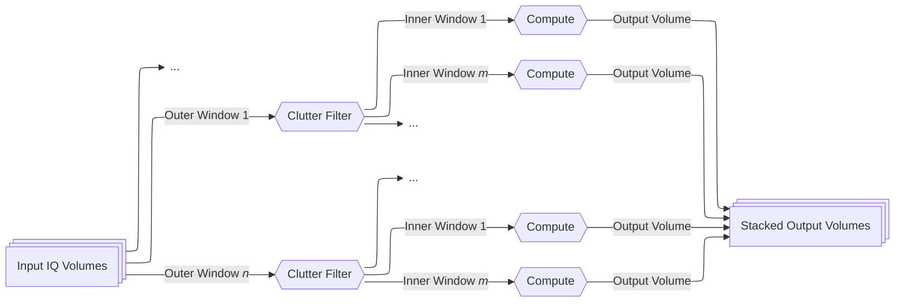
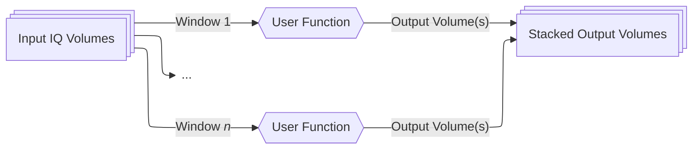

# Processing Beamformed IQ Data

Beamformed IQ signals contains very rich information about tissue and blood. ConfUSIus
lets you process these recordings to produce the following measures:

- **B-mode**, to visualize tissue anatomy.
- **Power Doppler**, to track changes in blood signal power, commonly used as a measure
  of relative cerebral blood volume in fUSI.
- **Axial velocity**, to estimate motion along the ultrasound beam.

You can also apply your own processing functions to compute other measures.
Blood-related measures usually require **clutter filtering** to suppress the much
stronger tissue echoes before calculating the output.

This guide covers IQ data requirements, built-in measures, clutter filtering, processing
windows, and custom workflows. To learn how to load beamformed IQ data into ConfUSIus,
see [Loading data](io.md#loading-data).

## Understanding Beamformed IQ Data

### What Are Beamformed IQ Signals?

A fUSI scanner transmits high-frequency pulses and records the returning echoes as
radio-frequency (RF) signals. IQ demodulation then converts these echoes into
complex-valued signals that preserve amplitude and phase while discarding the
high-frequency carrier. Finally, a beamforming algorithm combines the signals into a
volume; a sequence of volumes forms a **beamformed IQ recording**.

Each beamformed IQ sample can be written as

$$
\mathrm{IQ}(i,j,k,t)=A(i,j,k,t)e^{j\phi(i,j,k,t)},
$$

where $A$ is the echo amplitude, $\phi$ its phase, $(i,j,k)$ the voxel position, and $t$
the time. **Amplitude** reflects echo strength; **changes in phase** can reveal motion.

!!! info "Pulse repetition and compound sampling frequencies"
    With single plane-wave imaging, beamformed IQ volumes are acquired at the *pulse
    repetition frequency (PRF)*, usually in the kilohertz range. In **compounded
    imaging**, echoes from several plane-wave angles are combined into one
    volume[^montaldo2009]. The resulting *compound sampling frequency* is typically the
    PRF divided by the number of angles, often giving hundreds of volumes per second.
    However, some fUSI scanners add a delay between each beamformed IQ volume (often to
    avoid probe heating, or because of computer processing limits). In this case, the
    compound sampling frequency is lower.

### Data Format and Metadata

ConfUSIus represents IQ recordings as complex-valued
[VoxelData](voxeldata.md#the-voxeldata-model) arrays. For axial velocity computation,
the VoxelData array must also have `transmit_frequency` and `beamforming_sound_velocity`
attributes. Some formats contain these attributes, but others do not. You may supply
them manually after loading, or when creating an array with
[`create_voxeldata`][confusius.xarray.create_voxeldata].

For example:

```pycon
>>> import confusius as cf
>>> iq = cf.load("sub-01_task-rest_iq.zarr")
>>> iq
<xarray.DataArray 'iq' (time: 50000, k: 1, j: 118, i: 52)> Size: 2GB
dask.array<... shape=(50000, 1, 118, 52), dtype=complex64, chunksize=(1000, 1, 118, 52)>
Coordinates:
  * time     (time) float64 0.0 0.002 0.004 ... 100.0
  * k        (k) int64 0
  * j        (j) int64 0 1 2 ... 117
  * i        (i) int64 0 1 2 ... 51
  * z        (k, j, i) float64 ...
  * y        (k, j, i) float64 ...
  * x        (k, j, i) float64 ...
Indexes:
  ┌ z        VoxelToWorldIndex
  │ y
  └ x
Attributes:
    compound_sampling_frequency:  500.0
    pulse_repetition_frequency:   15000.0
    transmit_frequency:           15625000.0
    beamforming_sound_velocity:   1540.0
```

ConfUSIus can load beamformed IQ files from AUTC DAT, EchoFrame DAT, and Iconeus RAW
recordings. See the [I/O guide](io.md) for supported formats, or [Other
systems](io.md#other-systems) to convert your own complex-valued arrays.

!!! tip "Finding acquisition metadata"
    - `volume_acquisition_duration`: Usually the number of plane-wave angles divided by
      the PRF, with an optional delay between volumes.
    - `transmit_frequency`: Look in your probe specifications or acquisition settings
      (typically 5–10 MHz for clinical probes and 12–30 MHz for high-frequency
      small-animal probes).
    - `beamforming_sound_velocity`: Often set to 1540 m/s for soft tissue, but depends
      on tissue and temperature.

## Computing B-Mode, Power Doppler, and Velocity

ConfUSIus provides built-in functions to process beamformed IQ data using sliding
temporal windows. All IQ processing functions return Dask-backed VoxelData arrays. Call
[`.compute()`][xarray.DataArray.compute] to load the result into memory, or use
[`confusius.save`][confusius.io.save] to write it in chunks. See the [Processing
beamformed IQ recordings](../examples/_built/iq/process_beamformed_iq.md) for a
practical example.

### Power Doppler

**Power Doppler** is the most common fUSI measure of relative cerebral blood volume
changes. After removing tissue echoes with a clutter filter, ConfUSIus averages the
squared IQ magnitude over each Doppler window.

[`process_iq_to_power_doppler`][confusius.iq.process_iq_to_power_doppler] uses
`clutter_window_width` to determine the clutter filter window size and
`doppler_window_width` for power Doppler averaging. Its output is **signal power in
arbitrary units**, not an absolute measure blood volume.

```python
pwd = cf.iq.process_iq_to_power_doppler(
    iq, filter_method="svd_indices", low_cutoff=40
).compute()
```

### Axial Velocity

**Axial velocity** describes motion along the ultrasound beam.
[`process_iq_to_axial_velocity`][confusius.iq.process_iq_to_axial_velocity] estimates
it from phase changes between beamformed IQ samples, averaged over
`velocity_window_width` frames[^kasai1985]. The `lag` parameter determines the
separation between samples (`lag=1` compares consecutive frames).

Clutter filtering controls which motion dominates the estimate:

- **With tissue suppression:** the estimate primarily reflects blood motion.
- **Without a filter**: strong tissue echoes dominate, making it useful for tracking
  tissue motion associated with cardiac pulsatility, respiration[^zucker2025], or
  movement[^lemeurdiebolt2025].

```python
blood_velocity = cf.iq.process_iq_to_axial_velocity(
    iq, filter_method="svd_indices", low_cutoff=40, spatial_kernel=1
).compute()

tissue_velocity = cf.iq.process_iq_to_axial_velocity(iq).compute()
```

Values are in **m/s** and represent only the velocity component along the beam. The sign
depends on the scanner's IQ convention; verify which direction is positive using a
phantom or known flow.

!!! warning "Velocity aliasing"
    If the phase changes too much between compared samples, the velocity estimate
    becomes ambiguous and may appear to reverse direction. Reduce `lag` or increase the
    IQ sampling rate to measure faster motion without aliasing.

### B-Mode

**B-mode** visualizes tissue anatomy from echo strength.
[`process_iq_to_bmode`][confusius.iq.process_iq_to_bmode] averages the IQ magnitude
over `bmode_window_width` frames. It does not apply clutter filtering. Longer windows
give smoother images but may blur moving structures.

```python
bmode = cf.iq.process_iq_to_bmode(iq).compute()
```

## Clutter Filtering

Blood echoes are typically 40–60 dB weaker than tissue echoes (roughly 100–1000 times
lower in amplitude). **Clutter filtering** suppresses tissue signals so blood-related
measures can be computed reliably.

Tissue echoes are often strong and vary together across many voxels, while blood echoes
tend to be weaker and more localized. Tissue usually moves more slowly than blood, but
their Doppler frequencies can overlap—especially when the subject moves. This is why
frequency filtering alone is often insufficient.

### Available methods

=== "SVD filters"

    **Singular value decomposition (SVD)** separates IQ data into components ordered by
    their signal strength[^demene2015]. Strong, spatially coherent tissue signals tend
    to appear in the leading components, while weaker blood signals are spread across
    later ones. Removing leading components can therefore suppress tissue echoes.

    - **`svd_indices` (fixed cutoff):** Removes a fixed set of components in every
      window. This is the widely used default in fUSI
      studies[^ferrier2020][^rabut2020][^brunner2021][^nunez-elizalde2022].
    - **`svd_energy` (adaptive):** Chooses components to remove using their individual
      energies. Can respond to changing motion, but may over-filter and cause power
      Doppler drops during motion.
    - **`svd_cumulative_energy` (adaptive):** Uses the cumulative distribution of
      component energy. Can adapt to changing motion, but also suppresses global power
      changes, potentially removing meaningful widespread signals.

    !!! tip "Which SVD filter should I use?"
        Start with **`svd_indices`** for most recordings. For awake subjects with
        strong, variable motion, adaptive methods may
        help[^lemeurdiebolt2025][^bertolo2023]. However, they are less established and
        can impact the signals you want to measure. In particular, avoid
        `svd_cumulative_energy` when global hemodynamic changes are of interest.

=== "Butterworth filter"

    **`butterworth`** filters IQ signals by temporal frequency. A high-pass setting
    suppresses slow motion, but it cannot separate tissue from blood when their
    frequency ranges overlap. It may also remove slow flow in small vessels.

    For these reasons, **Butterworth filtering alone is generally unsuitable for fUSI**.
    It can be useful before SVD
    filtering[^brunner2020][^nunez-elizalde2022][^lemeurdiebolt2025] or in specialized
    applications such as tissue-motion tracking.

### Filter cutoffs

The meaning of `low_cutoff` and `high_cutoff` depends on the chosen method:

| Method | `low_cutoff` | `high_cutoff` |
| --- | --- | --- |
| `svd_indices` | Remove components with indices below this value (usually strong tissue components). | Remove components at or above this index (usually weak noise components). |
| `svd_energy` | Remove components with energy below this value. | Remove components with energy above this value. |
| `svd_cumulative_energy` | Remove components with cumulative energy below this value. | Remove components with cumulative energy above this value. |
| `butterworth` | Remove frequencies below this value (Hz). | Remove frequencies above this value (Hz). |

### Masks for SVD filtering

You can supply a `clutter_mask` to use only selected voxels when identifying
tissue-related components, which may improve filtering[^lemeurdiebolt2025].

```python
brain_mask = cf.load("brain_mask.zarr")

pwd = iq.fusi.iq.process_to_power_doppler(
    filter_method="svd_indices", clutter_mask=brain_mask, low_cutoff=50,
)
```

### Choosing a cumulative-energy cutoff

Because the energy distribution varies across time windows, choosing `high_cutoff` for
`svd_cumulative_energy` can be difficult.
[`compute_svd_cumulative_energy_threshold`][confusius.iq.compute_svd_cumulative_energy_threshold]
examines each window and finds the **minimum cumulative energy** corresponding to a
chosen singular-value index (accumulated from low-energy to high-energy components).
Using this minimum helps prevent excessive filtering in any window[^lemeurdiebolt2025].

```python
import confusius as cf

iq = cf.load("recording.zarr")["iq"]
brain_mask = cf.load("brain_mask.zarr")["mask"]

threshold = cf.iq.compute_svd_cumulative_energy_threshold(
    iq,
    singular_value_index=40,
    clutter_mask=brain_mask,
    window_width=200,
).compute()

pwd = iq.fusi.iq.process_to_power_doppler(
    filter_method="svd_cumulative_energy",
    clutter_mask=brain_mask,
    high_cutoff=threshold,
    clutter_window_width=200,
)
```

## Processing Windows and Custom Functions

### Nested Sliding Windows

For power Doppler and axial velocity, ConfUSIus uses **two nested slilding windows**:

1. **Clutter window:** Filter a block of IQ volumes to suppress tissue echoes.
2. **Measurement windows:** Compute one or more power Doppler or velocity volumes from
   smaller windows within that filtered block.

This lets you choose the filtering window independently of the output time resolution:

- `clutter_window_width` and `clutter_window_stride` control how much IQ data is used
  for each clutter-filtering step and how far that window advances.
- `doppler_window_width` / `velocity_window_width` and the corresponding strides control
  each measurement and its spacing in time.

B-mode uses only one window level because it does not need clutter filtering.



### Custom processing

The underlying [`process_iq_blocks`][confusius.iq.process_iq_blocks] function applies
**any user-defined function** to successive time windows. The built-in processing
methods use it internally, but you can call it directly to implement your own measures
or filters.

!!! note "Low-level interface"
    Unlike most ConfUSIus functions, `process_iq_blocks` takes a **Dask array**, not a
    VoxelData array. It returns processed data without managing coordinates or metadata.
    The built-in power Doppler, velocity, and B-mode functions handle those details for
    you.




## Working with Large Recordings

Beamformed IQ recordings can be tens or hundreds of gigabytes. ConfUSIus uses
[Dask](https://docs.dask.org/en/stable/) to process data in chunks, so the entire
recording does not need to fit in RAM. Most operations are **lazy**: the computation
runs when you call `.compute()` or save the result.

### Recommended: threaded scheduler

Dask's **threaded scheduler** is a good default for local IQ processing and is often
faster than a distributed cluster, which adds scheduling and data-transfer overhead.

Numerical operations such as SVD may already use multiple CPU threads through BLAS
libraries. Running several Dask tasks in parallel can therefore create too many
competing threads and slow down processing. We recommend limiting BLAS to one thread per
task using [`threadpoolctl`](https://github.com/joblib/threadpoolctl).

```python
import dask
import confusius as cf
from threadpoolctl import threadpool_limits

iq = cf.load("large_iq_data.zarr")

# Limit BLAS threads and configure Dask parallelism.
with threadpool_limits(limits=1, user_api="blas"):
    with dask.config.set(scheduler="threads", num_workers=8):
        pwd = iq.fusi.iq.process_to_power_doppler(low_cutoff=40)
        cf.save(pwd, "power_doppler.zarr")
```

Adjust `num_workers` based on your CPU and available memory. More workers are not always
faster, especially for memory-intensive operations such as SVD.

### Optional: distributed scheduler

For more control over worker resources or to monitor processing through a web dashboard,
you can start a local Dask `Client`:

```python
from dask.distributed import Client

client = Client(
    n_workers=4,
    threads_per_worker=2,
    memory_limit="8GB",  # Per worker.
)

# Process and save the recording.
pwd = iq.fusi.iq.process_to_power_doppler(low_cutoff=40)
cf.save(pwd, "power_doppler.zarr")
```

The dashboard is usually available at
**[http://localhost:8787/status](http://localhost:8787/status)**. If the port is already
in use, Dask may choose another. Check `client.dashboard_link` for the actual address.

The distributed scheduler is not necessarily faster, even for large recordings. Start
with the threaded scheduler and switch if you need its monitoring or resource-management
features.

!!! note "BLAS threads with distributed workers"
    When using separate worker processes, BLAS thread limits must also be applied within
    those processes. Dask Distributed generally sets thread-related environment
    variables for its workers, but you can configure them explicitly if needed.

### Processing remote recordings

IQ processing functions read and process the **first window while building the Dask task
graph**, before [`.compute()`][xarray.DataArray.compute] or
[`confusius.save`][confusius.save] runs. For remote Zarr recordings, this can cause
repeated downloads when creating multiple processing results.

For small subsets, load the data into memory once with
[`.compute()`][xarray.DataArray.compute]. For larger recordings, consider using a local
Zarr copy. After loading an array into memory, specify window widths explicitly because
the original Dask chunking is no longer available.

### Computing multiple measures together

When processing several measures from the same recording, use
[`dask.compute`][dask.compute] to share common input reads:

```python
import dask

pwd = iq.fusi.iq.process_to_power_doppler(...)
velocity = iq.fusi.iq.process_to_axial_velocity(...)
bmode = iq.fusi.iq.process_to_bmode(...)

pwd, velocity, bmode = dask.compute(pwd, velocity, bmode)
```

This avoids reading the same IQ data separately for each computation where tasks can be
shared.

For a complete example, see [Processing beamformed IQ
recordings](../examples/_built/iq/process_beamformed_iq.md).

## Next Steps

- **[Visualization](visualization.md):** Explore recordings with napari or create
  figures with Matplotlib.
- **[Quality control](quality-control.md):** Assess quality and identify artifacts.
- **[Registration](registration.md):** Correct motion and align data to anatomical
  templates.
- **[Signal processing](signal.md):** Extract regional signals and denoise recordings.

[^montaldo2009]:
    Montaldo, G., et al. "Coherent Plane-Wave Compounding for Very High Frame Rate
    Ultrasonography and Transient Elastography." IEEE Transactions on Ultrasonics,
    Ferroelectrics and Frequency Control, vol. 56, no. 3, Mar. 2009, pp. 489–506. DOI.org
    (Crossref), <https://doi.org/10.1109/TUFFC.2009.1067>.

[^demene2015]:
    Demené, Charlie, et al. "Spatiotemporal Clutter Filtering of Ultrafast Ultrasound
    Data Highly Increases Doppler and fUltrasound Sensitivity." IEEE Transactions on
    Medical Imaging, vol. 34, no. 11, Nov. 2015, pp. 2271–85. DOI.org (Crossref),
    <https://doi.org/10.1109/TMI.2015.2428634>.

[^baranger2018]:
    Baranger, J., et al. "Adaptive Spatiotemporal SVD Clutter Filtering for Ultrafast
    Doppler Imaging Using Similarity of Spatial Singular Vectors." IEEE Transactions on
    Medical Imaging, vol. 37, no. 7, 2018, pp. 1574–86. DOI.org (Crossref),
    <https://doi.org/10.1109/TMI.2018.2789499>.

[^lemeurdiebolt2025]:
    Le Meur-Diebolt, Samuel, et al. "Robust Functional Ultrasound Imaging in the Awake
    and Behaving Brain: A Systematic Framework for Motion Artifact Removal." bioRxiv,
    17 June 2025. DOI.org (Crossref), <https://doi.org/10.1101/2025.06.16.659882>.

[^bertolo2023]:
    Bertolo, Adrien, et al. "High Sensitivity Mapping of Brain-Wide Functional Networks
    in Awake Mice Using Simultaneous Multi-Slice fUS Imaging." Imaging Neuroscience,
    vol. 1, Nov. 2023, p. imag_a_00030. DOI.org (Crossref),
    <https://doi.org/10.1162/imag_a_00030>.

[^brunner2020]:
    Brunner, Clément, et al. "A Platform for Brain-Wide Volumetric Functional Ultrasound
    Imaging and Analysis of Circuit Dynamics in Awake Mice." Neuron, vol. 108, no. 5,
    Dec. 2020, pp. 861–875.e7. DOI.org (Crossref),
    <https://doi.org/10.1016/j.neuron.2020.09.020>.

[^zucker2025]:
    Zucker, Nicolas, et al. “Physio-fUS: A Tissue-Motion Based Method for Heart and
    Breathing Rate Assessment in Neurofunctional Ultrasound Imaging.” eBioMedicine, vol.
    112, Feb. 2025, p. 105581. DOI.org (Crossref),
    <https://doi.org/10.1016/j.ebiom.2025.105581>.

[^ferrier2020]:
    Ferrier, Jeremy, et al. “Functional Imaging Evidence for Task-Induced Deactivation
    and Disconnection of a Major Default Mode Network Hub in the Mouse Brain.” Proceedings
    of the National Academy of Sciences, vol. 117, no. 26, June 2020, pp. 15270–80. DOI.org
    (Crossref), <https://doi.org/10.1073/pnas.1920475117>.

[^rabut2020]:
    Rabut, Claire, et al. “Pharmaco-fUS: Quantification of Pharmacologically-Induced
    Dynamic Changes in Brain Perfusion and Connectivity by Functional Ultrasound Imaging
    in Awake Mice.” NeuroImage, vol. 222, Nov. 2020, p. 117231. DOI.org (Crossref),
    <https://doi.org/10.1016/j.neuroimage.2020.117231>.

[^brunner2021]:
    Brunner, Clément, et al. “Whole-Brain Functional Ultrasound Imaging in Awake
    Head-Fixed Mice.” Nature Protocols, vol. 16, no. 7, July 2021, pp. 3547–71. DOI.org
    (Crossref), <https://doi.org/10.1038/s41596-021-00548-8>.

[^nunez-elizalde2022]:
    Nunez-Elizalde, Anwar O., et al. “Neural Correlates of Blood Flow Measured by
    Ultrasound.” Neuron, vol. 110, no. 10, May 2022, pp. 1631-1640.e4. DOI.org
    (Crossref), <https://doi.org/10.1016/j.neuron.2022.02.012>.

[^kasai1985]:
    Kasai, C., Namekawa, K., Koyano, A., & Omoto, R. (1985). Real-time two-dimensional
    blood flow imaging using an autocorrelation technique. IEEE Transactions on Sonics
    and Ultrasonics, 32(3), 458–464. https://doi.org/10.1109/T-SU.1985.31615

