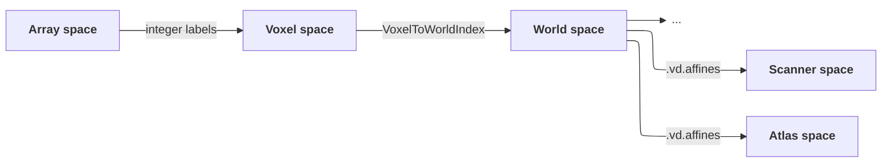

# The VoxelData Model

## VoxelData Arrays

**VoxelData** is the modality-independent
[`voxeldata`](https://github.com/confusius-tools/voxeldata) package's
[xarray.DataArray](https://docs.xarray.dev/en/stable/getting-started-guide/why-xarray.html#core-data-structures)
model. ConfUSIus uses it for beamformed IQ and fUSI recordings, atlas volumes,
decomposition maps, and displacement fields. Importing ConfUSIus also registers
VoxelData's flat **`.vd` accessor**. Use `.vd` for geometry and `.fusi` for
fUSI analysis, plotting, scaling, and saving; there is no `.fusi.affine` accessor.

A **VoxelData array** satisfies these requirements:

1. Dimensions `(*nonspatial_dims, k, j, i)`: spatial dimensions are mandatory and
   last. Optional `time`, `grid`, and any other leading dimensions may appear in any
   order.
2. A **`VoxelToWorldIndex`**, supplied by VoxelData, attached to the derived world
   coordinates `(z, y, x)`. Geometry is a shared `(4, 4)` affine or a stack indexed
   by ordered, nonspatial `geometry_dims`. Its batch shape matches those dimensions,
   independently of the parent array order.
3. For fUSI time series, attributes `units`, `volume_acquisition_reference`, and
   `volume_acquisition_duration` on `time`. These acquisition requirements belong
   to ConfUSIus, not to the generic VoxelData model.

ConfUSIus probe-pose APIs use **`grid`**. Existing affine stacks infer
`geometry_dims=("grid",)` and apply across time and other leading dimensions.
General VoxelData arrays may instead declare dependencies such as
`geometry_dims=("time", "view")`, requiring `(ntime, nview, 4, 4)` affines. A shared
matrix has `geometry_dims=()`, even with nonspatial dimensions. Identical matrices
are allowed. Timestamp dependencies remain independent of geometry dependencies.

!!! warning "Geometry-axis reindexing is unsupported"
    Use `.isel()` or `.sel()` to select/reorder dimensions listed in
    `data.vd.geometry_dims`, not native Xarray `.reindex()` or alignment that
    changes their labels. The world index is separate from their ordinary indexes;
    raw Xarray world-coordinate access can retain stale transform metadata.
    VoxelData access/validation detects mismatching indexed geometry labels.
    `.vd.reindex_voxels()` and `.vd.reindex_voxels_like()` explicitly rebuild geometry
    and remain supported.

Zarr saves preserve the ordered dependencies in `voxel_to_world_geometry_dims`,
along with primary geometry and named frames, without storing dense world arrays.
A shared mask may broadcast across geometry axes only when all corresponding
affines describe the same physical grid; otherwise select a geometry first.

### Dimension Ordering

Only the trailing `(k, j, i)` order is required. Leading dimensions have these
usual meanings, but their order is flexible:

| Dimension | Coordinate dtype | Optional | Typical axis meaning | Typical size |
|---|---|---|---|---|
| `...` | any | Yes | Components, regions, ... | Any  |
| `time` | float | Yes | Acquisition time | Thousands |
| `grid` | int | Yes | Probe poses | Tens |
| `k` | int | No | Elevation (stacking direction) | One to tens |
| `j` | int | No | Axial / depth | Tens to hundreds |
| `i` | int | No | Lateral | Tens to hundreds |

[`create_voxeldata`][confusius.xarray.create_voxeldata] preserves the relative
order of leading dimensions. Both `(time, grid, k, j, i)` and
`(grid, time, k, j, i)` are valid, as are arrays with extra leading dimensions.
Validation checks validity without changing the order.

When a stable order is useful, call `data.vd.canonicalize()` or
[`ensure_voxeldata`][confusius.validation.ensure_voxeldata]. Canonical order is
`(...extra_dims, grid, time, k, j, i)`, retaining the relative order of extra
dimensions. Neither inserts an absent `grid` or `time` dimension. ConfUSIus's
`ensure_voxeldata` additionally defaults and validates fUSI acquisition metadata;
`data.vd.ensure()` only applies the generic VoxelData contract.

!!! note "Migrating existing data"
    There is no `.fusi.affine` alias. Probe-pose APIs use `grid`; arbitrary geometry
    dimensions are not aliases for it. Older Zarr stores with a `pose` dimension
    but no explicit geometry-dependency metadata, or named frames in
    `attrs["affines"]`, are rejected rather than silently losing their frames. Load them with xarray, rename `pose` to
    `grid`, rebuild the index with explicit `named_affines=`, and save again.

Keeping spatial dimensions last has practical benefits:

- **Spatial blocks:** the last axes describe one volume. Use named selection such
  as `data.isel(time=t, grid=g)` rather than assuming what the first array axis means.
- **`(samples, features)` for free:** `data.stack(space=["k", "j", "i"])` reshapes to
  `(time, space)` without copy, matching the
  [scikit-learn](https://scikit-learn.org/stable/)/
  [statsmodels](https://www.statsmodels.org/stable/index.html) convention for
  statistical analysis.
- **Atlas-aligned:** `(k, j, i)` follows the same orientation as
  [BrainGlobe](https://brainglobe.info) atlases (e.g. Allen CCFv3).
- **Visualization-ready:** plotting `(time, k, j, i)` directly yields a correctly
  oriented `(j, i)` slice with `time`/`k` sliders, since many Python tools (e.g.,
  napari) expect the last two axes as the display axes.

### Metadata

The `units`, `volume_acquisition_reference`, and `volume_acquisition_duration`
attributes from requirement 3 above have the following meanings:

| Attribute | Meaning |
|---|---|
| `units` | Physical unit of the `time` coordinate values (`"s"` is typical). |
| `volume_acquisition_reference` | Which point of the acquisition window each `time` value marks: `"start"`, `"center"`, or `"end"`. |
| `volume_acquisition_duration` | Duration to acquire the whole `(k, j, i)` grid, in the same units as `time`. |

Additionally, the `VoxelToWorldIndex` attached to `(z, y, x)` carries its own `units`
attribute, which is the physical unit of the world coordinates (millimeters is typical).
It is accessed through the
[`.vd.units`][voxeldata.accessors.VoxelDataAccessor.units] property and set with
[`.vd.set_units(...)`][voxeldata.accessors.VoxelDataAccessor.set_units].

!!! warning "Don't set attributes on world coordinates directly"
    World coordinates `(z, y, x)` are always derived fresh from the
    `VoxelToWorldIndex`; any operation that touches the index (`.isel`,
    `.assign_coords`, etc.) regenerates them, including their `.attrs`, from the index's
    own state. Mutating `data.coords["z"].attrs[...]` directly is unsupported: the
    mutation is silently discarded the next time the coordinate is rebuilt. The index
    does write `units` onto each world coordinate's `.attrs` too, purely so external
    packages that read it from there still see it — but some xarray operations that
    combine several arrays (e.g. `xr.where`, which only keeps attrs from its `x`
    argument) can drop that copy from the result without touching the index's own
    `units`. Always trust `.vd.units`, never `.coords["z"].attrs["units"]`,
    when correctness matters.

### Creating and Validating VoxelData Arrays

To build a VoxelData array from raw arrays (NumPy, CuPy, etc.), use
[`create_voxeldata`][confusius.xarray.create_voxeldata]. If you then modified a
VoxelData array and want to check that it still satisfies the VoxelData model, use
[`validate_voxeldata`][confusius.validation.validate_voxeldata].

All ConfUSIus functions that expect a VoxelData array call
[`ensure_voxeldata`][confusius.validation.ensure_voxeldata] on their input, which
canonicalizes the DataArray first—reordering dimensions to `(...extra, time, grid, k,
j, i)`, restoring a voxel dimension collapsed to a scalar coordinate by a prior
[`.isel`][xarray.DataArray.isel], and filling in missing `time` metadata with sensible
defaults—before validating.

## Temporal Conventions

The `time` coordinate marks when each volume was acquired, in the units named by its
`units` attribute (seconds, typically). Because a volume is acquired over a nonzero
window rather than instantaneously, `time` alone doesn't say which point of that window
the value refers to—`volume_acquisition_reference` disambiguates this: `"start"`,
`"center"`, or `"end"` of the acquisition window. `volume_acquisition_duration` gives
the window's length, in the same units as `time`. Together, these three attributes let
downstream code (e.g. GLM HRF convolution) reconstruct the exact acquisition window of
every volume rather than treating `time` as an instantaneous sample.

The rest of this section covers how these definitions adapt for [multi-pose
data](multipose.md), where poses making up one volume are swept through sequentially
rather than acquired simultaneously.

### Unconsolidated Multi-Pose Data

While a VoxelData array still carries a `grid` dimension, `time` must be pose-dependent
with shape `(time, grid)` instead of the plain 1D coordinate above. `time` then
describes each pose's acquisition timestamp. 

In this shape, `volume_acquisition_duration` and `volume_acquisition_reference` describe
**one pose's own `(k, j, i)` acquisition window**, not the time it takes to sweep
through every pose. Resolving a single real timestamp requires selecting a scalar `grid`
first, which reduces `time` back to the plain 1D case.

### Consolidated Multi-Pose Data

[`consolidate_poses`][confusius.multipose.consolidate_poses] merges `grid` into the
sweep voxel dimension the poses were stepped along (`i`, `j`, or `k`, detected
automatically), so the result has no `grid` dimension left. Two things happen to
timing:

- `time` becomes an ordinary whole-array 1D coordinate again, but
  `volume_acquisition_duration`/`volume_acquisition_reference` are recomputed to
  describe the full sweep across every pose—from the earliest pose's onset to the
  latest pose's offset—rather than one pose's window.
- Each slice's own real timestamp survives separately as a new `slice_time` coordinate,
  with dims `(time, <sweep_dim>)` (or a single dim when `time` is scalar or absent),
  inheriting the pre-consolidation `time`'s `volume_acquisition_duration`/
  `volume_acquisition_reference`. `slice_time` requires the same three attributes as
  `time` and [`ensure_voxeldata`][confusius.validation.ensure_voxeldata] fills in
  missing ones the same way, defaulting `volume_acquisition_duration` from the median
  consecutive gap between slices along `<sweep_dim>`.

[`validate_voxeldata`][confusius.validation.validate_voxeldata] checks that every
slice's `slice_time` falls within its own volume's acquisition window, as defined by
`time` and its `volume_acquisition_duration`/`volume_acquisition_reference`.

This doesn't forbid overlap between consecutive volumes:
`volume_acquisition_duration` may exceed the spacing between `time` values, e.g
sliding-window beamformed IQ processing acquisition). It only constrains a slice against
its own volume's window.

### Slice Timing Correction

[`correct_slice_timings`][confusius.multipose.correct_slice_timings] uses `slice_time`
(or an unconsolidated pose-dependent `time`) to resample each slice's or pose's time
series onto the shared, whole-array `time` reference—working on both unconsolidated and
consolidated data. See the [Multi-Pose Imaging guide](multipose.md#pose-consolidation)
for a full example.

## Spatial Conventions

To localize a VoxelData array in physical space, ConfUSIus works with four kinds of
coordinate systems:

- **Array space**: the dense, zero-based array position along each spatial dimension.
- **Voxel space**: the `(i, j, k)` coordinate labels attached to the underlying array
  storage, coinciding with array space only when voxel labels themselves start at `0`
  and increase by `1`.
- **World space**: derived from voxel space through the DataArray's voxel-to-world
  affine transformation(s) and exposed as the coordinates `(x, y, z)`.
- **Reference spaces**: any coordinate system (atlas, scanner, etc.) linked to the world
  space through affine transforms stored in `.vd.affines`.

For most recordings, one voxel-to-world affine defines one world grid for the whole
DataArray. Multi-pose acquisitions are the main exception: they carry one affine per
`grid`, so `(x, y, z)` become pose-dependent coordinates and a scalar `grid` selection
is required before selecting by world coordinate.

Each space feeds the next: array position gets a voxel label, a voxel label gets a world
coordinate, and a world coordinate can reach any number of reference spaces:



### Array Space

The array space defines the dense, zero-based position along each spatial dimension:
position `0` is always the array's first stored element, position `dim_size - 1` its
last, and every position in between is contiguous. In Xarray,
[`.isel`][xarray.DataArray.isel] indexes by array position. If you're used to NumPy,
think of array space as the "axis index" of each dimension, for example `data[0, 0, 0]`
is the first voxel in array space, `data[-1, -1, -1]` the last.

### Voxel Space

The Voxel space is defined by the DataArray's `(i, j, k)` coordinate labels, indexed by
label with [`.sel`][xarray.DataArray.sel]. Labels coincide with array space for a
freshly built DataArray, but the two diverge once a DataArray is cropped or strided from
a larger one:

```pycon
>>> cropped = data.isel(i=slice(3, 6))
>>> cropped.coords["i"].values
array([3, 4, 5])
>>> cropped.isel(i=0).coords["i"].item()  # Array position 0's label.
3
>>> cropped.sel(i=3).coords["i"].item()   # The voxel labeled 3.
3
```

Use [`reindex_voxels`][voxeldata.affine.reindex_voxels] to rebase voxel labels back to
dense array-space positions—see [Rebasing voxel coordinates to dense
positions](xarray.md#rebasing-voxel-coordinates-to-dense-positions) in Working with
Xarray.

### World Space

The world space is defined by the DataArray's voxel-to-world affine transformation (or
transformations, for multi-grid data) contained in the `VoxelToWorldIndex` and exposed
as coordinates `(x, y, z)`. For ordinary single-pose data these coordinates are arrays
with shape `(k, j, i)`. For multi-pose data they are pose-dependent with shape `(grid,
k, j, i)`, so selecting in world space requires a scalar `grid` first. The unit shared
by `x`/`y`/`z` is exposed as `data.vd.units` and set with
`data.vd.set_units(...)`; millimeters are the usual default for fUSI
recordings.

!!! warning "Units are not enforced"
    ConfUSIus does not check or convert between units across its APIs—`units` is
    metadata only. We plan to make the data model more unit-aware in the future.

World space is not tied to any one physical space—it's whatever space the DataArray's
voxel-to-world affine currently encodes, and that changes over the course of a pipeline.
A freshly loaded recording is typically expressed in scanner space: the space of the
first acquired probe pose, with origin at the probe surface and axes along lateral,
depth, and elevation. Once the data is resampled or registered, world space becomes
whatever space that operation targeted instead: an atlas template (e.g. Allen CCFv3),
another recording's grid, or any other space you choose.

World coordinates are set when attaching a `VoxelToWorldIndex` to the DataArray.
Different loaders derive them in different ways:

- **EchoFrame**: Lateral and axial coordinates are read from the acquisition metadata
  file.
- **AUTC**: Spacing must be supplied explicitly to
  [`convert_autc_dats_to_zarr`][confusius.io.convert_autc_dats_to_zarr]—AUTC files carry
  no spacing metadata of their own. Origin is optional and defaults to a probe-centered,
  surface-referenced position when omitted.
- **Iconeus SCAN**: Coordinates are derived from Iconeus' laboratory space, reordered
  and rotated by 90 degrees about the axial axis so typical coronal recordings have `z`
  elevation, `y` depth, and `x` lateral. The laboratory space's axial axis is flipped so
  that it is always positive and increases with depth.
- **NIfTI**: Coordinates are derived from the "best" affine transformation found in the
  file header, or from whichever one [`load_nifti`][confusius.io.load_nifti]'s
  `coordinate_affine` argument selects explicitly.

!!! tip "The "best" NIfTI affine"
    NIfTI files can store two affine transforms in their header: `qform` and a
    `sform`, each with an associated integer code indicating whether the affine is
    valid (`code > 0`) and which space it points to.

    - `qform` cannot contain shears and is typically used to encode transforms from
      voxel space to scanner space. 
    - `sform` can be any arbitrary affine transformation and is typically used to encode
      transforms from voxel space to "standard" reference spaces, such as a recording's
      world space or an atlas space.

    By default, ConfUSIus follows the [same logic as
    NiBabel](https://nipy.org/nibabel/nifti_images.html#choosing-the-image-affine): if
    `sform_code > 0` the `sform` is used to define the world coordinates; otherwise, if
    `qform_code > 0` the `qform` is used. If both codes are zero a warning is emitted
    and coordinates fall back to a diagonal affine built from the NIfTI `pixdim` field.
    Pass `coordinate_affine="sform"`/`"qform"` to force one explicitly.

Hand-constructed DataArrays get whatever voxel-to-world affine the user provides via
[`create_voxeldata`][confusius.xarray.create_voxeldata].

#### Voxel-to-World Affine

The voxel-to-world affine is a `(4, 4)` homogeneous matrix (or a `(grid, 4, 4)` stack
for multi-pose data) mapping `(k, j, i)` voxel-space coordinates to `(z, y, x)`
world-space coordinates:

```
[z, y, x, 1] = voxel_to_world @ [k_label, j_label, i_label, 1]
```

The voxel-to-world affine can be read with
[`.vd.voxel_to_world`][voxeldata.accessors.VoxelDataAccessor.voxel_to_world], or
replaced outright with
[`.vd.set_voxel_to_world`][voxeldata.accessors.VoxelDataAccessor.set_voxel_to_world].

Scalar spatial selection, such as `data.isel(k=0)`, removes a required voxel
dimension. Before `.vd.apply()` or `.vd.reindex_voxels()`, restore it explicitly:
`ensure_voxeldata(data.isel(k=0)).vd.apply(matrix)`. A scalar-selected `grid` is
not restored; it selects one probe pose and its geometry.

That raw mapping is rarely what you want directly, though: most tools that consume
world-space geometry think in [array space](#array-space), not in whatever labels the
`(k, j, i)` coordinates happen to carry after upstream cropping or striding. If you
specifically need the affine mapping array space to world space (that packages like
NiBabel or the NIfTI format expect) call
[`reindex_voxels`][voxeldata.affine.reindex_voxels] first: it rebases the voxel space to
the array space and updates `voxel_to_world` to match, so the affine you then read off
directly maps dense array positions instead of labels.

#### Origin, Spacing, Direction

[`.vd.origin`][voxeldata.accessors.VoxelDataAccessor.origin],
[`.vd.spacing`][voxeldata.accessors.VoxelDataAccessor.spacing], and
[`.vd.direction`][voxeldata.accessors.VoxelDataAccessor.direction] (see [Global
Helpers](xarray.md#global-helpers) in Working with Xarray) describe the same
voxel-to-world affine, but anchored to array space rather than voxel labels. They are
the typical parameters used to describe a world-space grid in neuroimaging tools like
ITK:

- **origin**: world position of the array space's origin. Keyed by world axis
  (`z`/`y`/`x`).
- **spacing**: world distance covered by one array-space step. Keyed by voxel axis
  (`k`/`j`/`i`).
- **direction**: `(3, 3)` matrix of unit world-space direction vectors, one per
  array-space axis: columns are voxel axes (`k`/`j`/`i`), rows are world axes
  (`z`/`y`/`x`). Direction flips sign on an axis whose labels run descending (e.g.
  after `.isel(dim=slice(None, None, -1))`).

For example, if `k`'s coordinates are `[0, 2, 4]` (every other voxel was kept, e.g. by
`.isel(k=slice(None, None, 2))`) and the voxel-to-world affine's scale along `k` is
`0.1`, then `data.vd.spacing["k"]` is `0.2`, not `0.1`: consecutive array positions
are two *sampled voxels* apart. Together, `origin`/`spacing`/`direction` reconstruct
world coordinates from array position rather than from labels:

```
world = origin + direction @ (spacing * array_position)
```

### Reference Spaces

ConfUSIus stores affine transformations relating the DataArray's current world space to
any number of other named spaces on the VoxelData index. Read them through
`data.vd.affines` or `data.vd.get_affine(name)`; add or remove them with
`data.vd.set_affine(name, matrix)` and `data.vd.remove_affine(name)`. Mutators return
a new DataArray unless `inplace=True` is specified. Named frames never live in
DataArray attributes. Reference spaces can be an atlas space, a scanner or lab space, another
recording's world space, or a space the data has already moved away from (e.g. the raw
probe-relative space a recording started in).

A space counts as a "reference space" rather than *the* world space only because
reaching it currently takes an affine.
[`.vd.apply`][voxeldata.accessors.VoxelDataAccessor.apply] can turn any one of
them into the world space itself (see [Switching World
Spaces](#switching-world-spaces)). Each reference space is stored in `.vd.affines`
as a homogeneous affine matrix in `(z, y, x)` convention that maps a world-space point
to the corresponding point in the reference space. Most are plain `(4, 4)` matrices;
for multi-pose data they may also be stacked `(grid, 4, 4)` affines with one entry per
pose.

Several loaders populate `.vd.affines` automatically:

- **NIfTI**: The world space is whichever affine (`sform` or `qform`) was selected; its
  own entry (`"world_to_sform"` or `"world_to_qform"`) is the identity. When the other
  one is also valid, it is stored under the other key, so the world space can be
  switched between the two. [`save_nifti`][confusius.io.save_nifti] can write any
  named affine in `.vd.affines` back to the header via its `qform=`/`sform=`
  arguments, defaulting to `"world_to_qform"`/`"world_to_sform"` when not specified.
- **Iconeus SCAN**: [`load_scan`][confusius.io.load_scan] uses the modified Iconeus
  laboratory space (see [World Space](#world-space)) as world space, so its
  `"world_to_lab"` entry is the identity. A `"world_to_probe"` entry maps world
  coordinates to the first pose's probe space (`z` elevation, `y` depth, `x` lateral),
  so the world space can be switched to the probe and back. When `bps_path` is supplied,
  the `"world_to_brain"` entry maps world coordinates to the Iconeus brain space defined
  by the BPS file.

Registration transforms are handled separately from `.vd.affines`.
[`register_volume`][confusius.registration.register_volume] returns the estimated
transform explicitly but does not store automatically in `.vd.affines`.

!!! question "Why store affines as world → reference instead of voxel → reference?"
    A voxel → reference affine breaks the moment the voxel space is reindexed—via
    [`reindex_voxels`][voxeldata.affine.reindex_voxels] or when saving to NIfTI. A world
    → reference affine doesn't have this problem: it operates on world coordinate
    values, which stay physically correct through reindexing.
    [`save_nifti`][confusius.io.save_nifti] reconstructs the voxel → reference NIfTI
    affine it needs by composing the stored world → reference affine with the
    DataArray's current voxel → world affine at save time.

## Switching World Spaces

To switch a DataArray's world space to one of its reference spaces, apply the affine
that relates them: [`.vd.apply`][voxeldata.accessors.VoxelDataAccessor.apply]
takes a `(4, 4)` affine (or a key into `.vd.affines`) and re-expresses the
DataArray's world coordinates in that space, which becomes the new world space. For
multi-pose data, applying a single affine broadcasts it over every pose, while a
stacked affine is applied pose-by-pose.

Take the `sform`/`qform` example from [Reference Spaces](#reference-spaces). A NIfTI
file with `sform_code > 0` anchors its world space to the `sform` space, and the
relationship to the `qform` space (a 90° rotation in the `(z, y)` plane, here) is
carried on the `world_to_qform` affine attribute:

```pycon
>>> da.coords["z"].values.flatten()
array([-1., -1., -1., -1.,  0.,  0.,  0.,  0.,  1.,  1.,  1.,  1.])
>>> da.coords["y"].values.flatten()
array([0.5, 1.5, 2.5, 3.5, 0.5, 1.5, 2.5, 3.5, 0.5, 1.5, 2.5, 3.5])
>>> da.vd.affines["world_to_qform"]
array([[ 0., -1.,  0.,  0.],
       [ 1.,  0.,  0.,  0.],
       [ 0.,  0.,  1.,  0.],
       [ 0.,  0.,  0.,  1.]])
```

Applying `world_to_qform` absorbs the rotation into the DataArray's voxel-to-world
affine, and the derived `z`/`y` coordinates change accordingly. The `qform` space
becomes the new world space, so `"world_to_qform"` is now the identity. The `sform`
entry, identity before, now holds the inverse rotation, so the `sform` space stays
recoverable.

```pycon
>>> da_q = da.vd.apply("world_to_qform")
>>> da_q.coords["z"].values.flatten()
array([-0.5, -1.5, -2.5, -3.5, -0.5, -1.5, -2.5, -3.5, -0.5, -1.5, -2.5,
       -3.5])
>>> da_q.coords["y"].values.flatten()
array([-1., -1., -1., -1.,  0.,  0.,  0.,  0.,  1.,  1.,  1.,  1.])
>>> da_q.vd.affines
{'world_to_sform': array([[ 0.,  1.,  0.,  0.],
       [-1.,  0.,  0.,  0.],
       [ 0.,  0.,  1.,  0.],
       [ 0.,  0.,  0.,  1.]]), 'world_to_qform': array([[1., 0., 0., 0.],
       [0., 1., 0., 0.],
       [0., 0., 1., 0.],
       [0., 0., 0., 1.]])}
```

See [Affine Transforms](xarray.md#affine-transforms) in Working with Xarray for
the rest of the `.vd` API (`voxel_to_world`, `set_voxel_to_world`, `to`).
